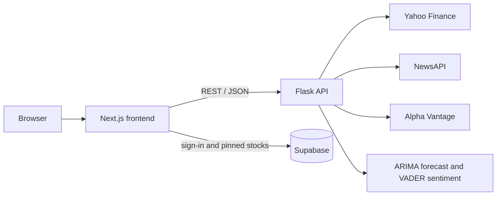

# Stock Dashboard

A full-stack stock market dashboard with live prices, a 7-day price forecast and sentiment analysis of the latest news headlines. Users sign in to pin the stocks they follow.

Built with Next.js (TypeScript) and a Python Flask API.

<!-- Live demo: add the Vercel link here once deployed -->
<!-- Screenshots: put images in docs/ and reference them here, e.g.  -->

## Features

- **Live prices**: the latest price for each stock, from Yahoo Finance via `yfinance`.
- **Price charts**: switch between a 3-month daily view and today's prices in 5-minute steps, drawn with Recharts.
- **Price forecast**: a 7-day forecast from an ARIMA(10,1,0) model fitted to six months of daily closing prices (`statsmodels`), shown on the 3-month view.
- **News sentiment**: the latest headlines for each stock from NewsAPI, each scored positive, neutral or negative with VADER.
- **Trending news**: a general financial news feed that tags which stocks each headline mentions.
- **Search**: searches a built-in list of 69 popular stocks first, then falls back to Alpha Vantage's symbol search.
- **Accounts and pinned stocks**: email and password sign-in with Supabase. Pinned stocks appear together on your dashboard, and row-level security means each user can only read and change their own.

## How it works



| Part | Built with |
| --- | --- |
| Frontend | Next.js 14, React, TypeScript, Tailwind CSS, Recharts |
| Backend | Python, Flask, pandas, statsmodels, vaderSentiment, yfinance |
| Data and accounts | Supabase (Postgres and Auth), NewsAPI, Alpha Vantage |

```
dashboard-project/
├── backend/
│   ├── app.py               # Flask API with all the endpoints
│   ├── services/
│   │   ├── news_fetcher.py  # headlines from NewsAPI
│   │   ├── predictor.py     # ARIMA price forecast
│   │   └── sentiment.py     # VADER sentiment scores
│   ├── stocks.json          # the 69 stocks used for search and stock pages
│   └── requirements.txt
├── frontend/
│   ├── src/app/             # pages: login, dashboard, news, stocks/[ticker]
│   ├── components/  hooks/  lib/  utils/
│   └── package.json
├── main.js                  # optional Electron desktop wrapper
└── .env.example
```

## Running it locally

**You'll need:**

- Python 3.10 to 3.12
- Node.js 18.17 or newer
- Free API keys from [NewsAPI](https://newsapi.org/register) and [Alpha Vantage](https://www.alphavantage.co/support/#api-key)

### 1. Clone the repo and add your keys

```bash
git clone https://github.com/ch2911/dashboard-project.git
cd dashboard-project
cp .env.example .env
```

Open `.env` and paste in your two keys.

### 2. Start the backend

```bash
cd backend
python3 -m venv .venv
source .venv/bin/activate        # on Windows: .venv\Scripts\activate
pip install -r requirements.txt
python app.py
```

The API runs at http://127.0.0.1:5000. Leave this terminal open.

### 3. Start the frontend

In a second terminal, from the project folder:

```bash
cd frontend
npm install
npm run dev
```

Open http://localhost:3000, sign up with an email and password, click the link in the confirmation email, then log in. Search for a stock and pin it to add it to your dashboard.

### If something doesn't work

- **Port 5000 is already in use (macOS):** AirPlay Receiver uses port 5000. Turn it off in System Settings → General → AirDrop & Handoff. Alternatively, run the API on another port with `flask --app app run --port 5001` and start the frontend with `NEXT_PUBLIC_API_URL=http://127.0.0.1:5001 npm run dev`.
- **No headlines or search results:** check both keys are in the `.env` file in the project folder (not inside `backend/`). The free API plans also have daily request limits.

## API endpoints

| Endpoint | Returns |
| --- | --- |
| `GET /price?stock=AAPL` | Latest price and percentage change |
| `GET /price_history?stock=AAPL&range=daily` | Closing prices: `daily` gives the last 3 months, `intraday` gives today in 5-minute steps |
| `GET /predict?stock=AAPL` | 7-day ARIMA forecast |
| `GET /sentiment?stock=AAPL` | Latest headlines about the stock, with sentiment scores |
| `GET /trending_news` | General financial headlines, with sentiment and the stocks they mention |
| `GET /search_stock?q=apple` | Up to 10 matching stocks |

## Using your own Supabase project (optional)

By default the app signs users in through the author's Supabase project. To use your own:

1. Create a free project at [supabase.com](https://supabase.com).
2. In the SQL editor, create the pinned-stocks table and its access rules:

   ```sql
   create table public.favorites (
     id uuid primary key default gen_random_uuid(),
     user_id uuid not null references auth.users (id) on delete cascade,
     symbol text not null,
     inserted_at timestamp default now()
   );

   alter table public.favorites enable row level security;

   create policy "Allow individual read access" on public.favorites
     for select using (auth.uid() = user_id);
   create policy "Allow individual insert access" on public.favorites
     for insert with check (auth.uid() = user_id);
   create policy "Allow individual delete access" on public.favorites
     for delete using (auth.uid() = user_id);
   ```

3. Replace the URL and anon key in `frontend/lib/supabaseClient.ts` with your project's own, from Project Settings → API.

## Deployment

The frontend is built as static pages and hosted on Vercel. The Flask API runs separately on Render.

| Service | Settings |
| --- | --- |
| Render (API) | Web service with root directory `backend`, build command `pip install -r requirements.txt` and start command `gunicorn app:app`. Environment variables: `ALPHAVANTAGE_KEY`, `NEWSAPI_KEY` and `PYTHON_VERSION=3.12.7`. |
| Vercel (frontend) | Root directory `frontend`, with the environment variable `NEXT_PUBLIC_API_URL` set to the Render URL. |
| Supabase | Under Authentication → URL Configuration, set the Site URL to the Vercel URL so confirmation emails link back to the live site. |

## Desktop app

`main.js` wraps the app in Electron. It serves the static frontend build (`frontend/out`) and launches a PyInstaller build of the backend (`backend/dist/app`). Running `npm run dist` in the project folder packages it as a macOS `.dmg`.

## Notes

- The forecast is a simple statistical model built for learning and demonstration. It isn't financial advice.
- Yahoo Finance data comes from an unofficial API, and the free NewsAPI and Alpha Vantage plans limit daily requests, so the occasional request can fail.
