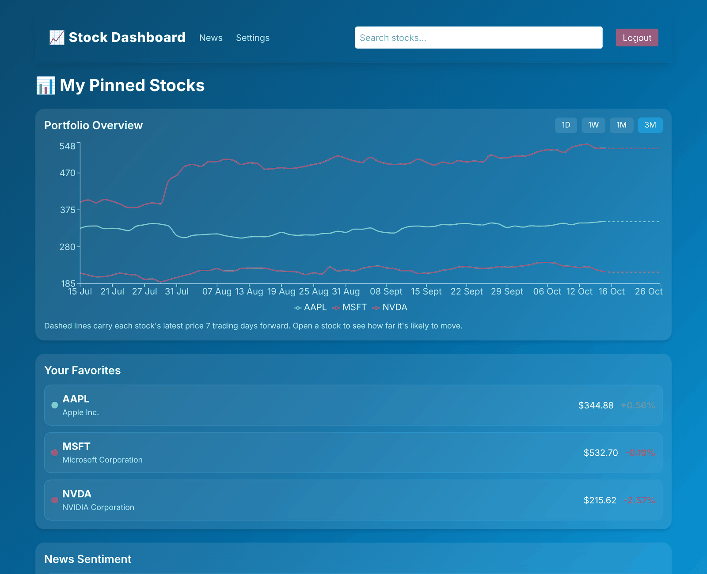
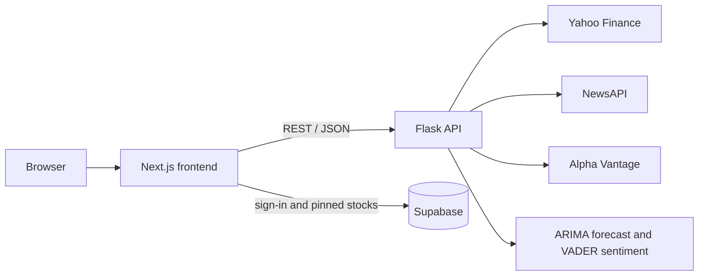

# Stock Dashboard

[](https://github.com/ch2911/dashboard-project/actions/workflows/ci.yml)

A full-stack stock market dashboard with live prices, a 7-day price forecast and sentiment analysis of the latest news headlines. Users sign in to pin the stocks they follow.

Built with Next.js (TypeScript) and a Python Flask API.

**Live demo:** [ch2911.github.io/dashboard-project](https://ch2911.github.io/dashboard-project/). The API sleeps when nobody has used it for a while, so the first load can take up to a minute.

<!-- Screenshots: put images in docs/ and reference them here, e.g.  -->

## Features

- **Live prices**: the latest price for each stock, from Yahoo Finance via `yfinance`.
- **Price charts**: switch between a 3-month daily view and today's prices in 5-minute steps, drawn with Recharts.
- **Price forecast**: a 7-day forecast from an ARIMA(10,1,0) model fitted to six months of daily closing prices (`statsmodels`), shown on the 3-month view.
- **News sentiment**: the latest headlines mentioning each stock's ticker or company name, from NewsAPI, each scored positive, neutral or negative with VADER.
- **Trending news**: a general financial news feed that tags which stocks each headline mentions.
- **Search**: searches a built-in list of 69 popular stocks first, then falls back to Alpha Vantage's symbol search.
- **Accounts and pinned stocks**: email and password sign-in with Supabase. Pinned stocks appear together on your dashboard, and row-level security means each user can only read and change their own.

## How it works



| Part | Built with |
| --- | --- |
| Frontend | Next.js 14, React, TypeScript, Tailwind CSS, Recharts |
| Backend | Python, Flask, pandas, statsmodels, vaderSentiment, yfinance |
| Data and accounts | Supabase (Postgres and Auth), NewsAPI, Alpha Vantage |
| Testing and deployment | pytest, Vitest, GitHub Actions, GitHub Pages, Render |

```
dashboard-project/
├── backend/
│   ├── app.py               # Flask API with all the endpoints
│   ├── gunicorn.conf.py     # server settings used on Render (threads, timeout)
│   ├── services/
│   │   ├── cache.py         # short-lived caches for prices, forecasts, news and searches
│   │   ├── market_data.py   # Yahoo Finance prices, with retries
│   │   ├── news_fetcher.py  # headlines from NewsAPI
│   │   ├── price_alerts.py  # finds big daily moves in pinned stocks and emails them
│   │   ├── predictor.py     # ARIMA price forecast
│   │   └── sentiment.py     # VADER sentiment scores
│   ├── tests/               # pytest suite (external APIs are faked)
│   ├── send_price_alerts.py # emails users about big daily moves (run by GitHub Actions)
│   ├── stocks.json          # the 69 stocks searched before falling back to Alpha Vantage
│   ├── requirements.txt
│   └── requirements-dev.txt # adds pytest for running the tests
├── frontend/
│   ├── src/app/             # pages: login, dashboard, news, stocks (any ticker: /stocks/?ticker=AAPL)
│   ├── components/  hooks/  lib/  utils/
│   └── package.json
├── .github/workflows/
│   ├── ci.yml               # tests, then deploys to GitHub Pages
│   ├── smoke-test.yml       # checks the live site every morning
│   └── price-alerts.yml     # sends price alert emails during market hours
├── scripts/smoke_test.py    # the checks the smoke test runs
└── .env.example
```

## Running it locally

**You'll need:**

- Python 3.10 to 3.12
- Node.js 18.17 or newer
- Free API keys from [NewsAPI](https://newsapi.org/register) and [Alpha Vantage](https://www.alphavantage.co/support/#api-key)

### 1. Clone the repo and add your keys

```bash
git clone https://github.com/ch2911/dashboard-project.git
cd dashboard-project
cp .env.example .env
```

Open `.env` and paste in your two keys.

### 2. Start the backend

```bash
cd backend
python3 -m venv .venv
source .venv/bin/activate        # on Windows: .venv\Scripts\activate
pip install -r requirements.txt
python app.py
```

The API runs at http://127.0.0.1:5000. Leave this terminal open.

### 3. Start the frontend

In a second terminal, from the project folder:

```bash
cd frontend
npm install
npm run dev
```

Open http://localhost:3000, sign up with an email and password, click the link in the confirmation email, then log in. Search for a stock and pin it to add it to your dashboard.

### If something doesn't work

- **Port 5000 is already in use (macOS):** AirPlay Receiver uses port 5000. Turn it off in System Settings → General → AirDrop & Handoff. Alternatively, run the API on another port with `flask --app app run --port 5001` and start the frontend with `NEXT_PUBLIC_API_URL=http://127.0.0.1:5001 npm run dev`.
- **No headlines or search results:** check both keys are in the `.env` file in the project folder (not inside `backend/`). The free API plans also have daily request limits.

## API endpoints

| Endpoint | Returns |
| --- | --- |
| `GET /price?stock=AAPL` | Latest price and percentage change |
| `GET /price_history?stock=AAPL&range=daily` | Closing prices: `daily` gives the last 3 months, `intraday` gives today in 5-minute steps |
| `GET /predict?stock=AAPL` | 7-day ARIMA forecast |
| `GET /sentiment?stock=AAPL` | Latest headlines about the stock, with sentiment scores |
| `GET /trending_news` | General financial headlines, with sentiment and the stocks they mention |
| `GET /search_stock?q=apple` | Up to 10 matching stocks |
| `GET /health` | Whether the server is up and which API keys are set (not their values) |

## Using your own Supabase project (optional)

By default the app signs users in through the author's Supabase project. To use your own:

1. Create a free project at [supabase.com](https://supabase.com).
2. In the SQL editor, create the pinned-stocks table and its access rules:

   ```sql
   create table public.favorites (
     id uuid primary key default gen_random_uuid(),
     user_id uuid not null references auth.users (id) on delete cascade,
     symbol text not null,
     inserted_at timestamp default now()
   );

   alter table public.favorites enable row level security;

   create policy "Allow individual read access" on public.favorites
     for select using (auth.uid() = user_id);
   create policy "Allow individual insert access" on public.favorites
     for insert with check (auth.uid() = user_id);
   create policy "Allow individual delete access" on public.favorites
     for delete using (auth.uid() = user_id);
   ```

   Then run `supabase/favorites_hardening.sql`, which only lets users pin real-looking tickers, each once, up to 50.

3. Replace the URL and anon key in `frontend/lib/supabaseClient.ts` with your project's own, from Project Settings → API.

## Price alert emails

Users get an email when one of their pinned stocks moves at least a set percentage from the previous close in a day (5% unless they choose otherwise). Each stock is emailed at most once per user per trading day, and several moves are grouped into one email.

`backend/send_price_alerts.py` does the checking. It runs every 30 minutes on weekdays during US market hours from `.github/workflows/price-alerts.yml`, rather than on Render, because the free Render server sleeps when idle. Emails go through [Resend](https://resend.com). `frontend/components/PriceAlertSettings.tsx` is a settings section where users turn alerts on or off and choose their threshold.

To turn it on:

1. Run `supabase/price_alerts.sql` once in the Supabase SQL editor. It adds the `alert_settings` and `alerts_sent` tables.
2. In the GitHub repo, under Settings → Secrets and variables → Actions, add:
   - secrets `SUPABASE_SERVICE_ROLE_KEY` (Supabase → Project Settings → API keys) and `RESEND_API_KEY`
   - variables `SUPABASE_URL` (e.g. `https://xxxx.supabase.co`) and `ALERT_FROM_EMAIL` (e.g. `Stock Dashboard <alerts@yourdomain.com>`, on a domain verified in Resend)
3. Run the "Price alerts" workflow by hand from the Actions tab to check it works.

### Demo mode (no email domain yet)

Without a domain verified in Resend, emails can only be sent from `onboarding@resend.dev`, and Resend only delivers those to the address the Resend account was created with. So the alerts work end to end, but only for the site owner. To run like that:

1. Set `ALERT_FROM_EMAIL` to `Stock Dashboard <onboarding@resend.dev>`.
2. Add a repository variable `ALERT_OWNER_ID` set to your own Supabase user id (Supabase → Authentication → Users, the "UID" column). Your login must use the same email as your Resend account.

With `ALERT_OWNER_ID` set, the alert job only emails that user, and the settings page shows a demo-mode note and turns the alert controls off for everyone else. The site picks up the variable the next time it's deployed (any push to `main`, or re-run the CI/CD workflow).

To open alerts to everyone: verify a domain in Resend, change `ALERT_FROM_EMAIL` to an address on it, delete the `ALERT_OWNER_ID` variable, and re-run the CI/CD workflow so the site is rebuilt.

## Running the tests

The backend tests replace Yahoo Finance, NewsAPI and Alpha Vantage with fakes, so they run without API keys or a network connection.

```bash
cd backend
pip install -r requirements-dev.txt
pytest --cov=app --cov=services
```

The frontend tests check the helpers that call the API, including what happens when a request fails or times out:

```bash
cd frontend
npm test
```

### Smoke test

`scripts/smoke_test.py` checks the live site: it wakes the API, then calls every endpoint and fails if any of them errors, returns the wrong kind of data or takes longer than 20 seconds. It runs every morning in GitHub Actions and can be run by hand:

```bash
python scripts/smoke_test.py https://your-api.onrender.com
```

## Deployment

Every push and pull request runs the GitHub Actions workflow in `.github/workflows/ci.yml`:

1. **Backend tests:** the pytest suite, with a coverage report.
2. **Frontend tests and build:** the Vitest tests, then `next build`, which also lints and type-checks the code.
3. **Deploy:** on `main`, once both jobs pass, the static site is published to GitHub Pages. Render's auto-deploy waits for the same checks, so the API only updates when the tests pass.

A second workflow, `.github/workflows/smoke-test.yml`, runs the smoke test against the live site every morning. It can also be started from the Actions tab after a deploy.

| Service | Setup |
| --- | --- |
| GitHub Pages (frontend) | In the repo's Settings → Pages, set Source to **GitHub Actions**. Under Settings → Secrets and variables → Actions → Variables, add `API_URL` set to the Render URL. |
| Render (API) | Web service with root directory `backend`, build command `pip install -r requirements.txt`, start command `gunicorn app:app`, and Auto-Deploy set to **After CI Checks Pass**. Environment variables: `ALPHAVANTAGE_KEY`, `NEWSAPI_KEY`, `PYTHON_VERSION=3.12.7`, and `SUPABASE_SERVICE_ROLE_KEY` (Supabase → Project Settings → API; needed for "Delete profile" on the settings page, and must never go in the frontend). |
| Supabase | Under Authentication → URL Configuration, set the Site URL to the GitHub Pages address so confirmation emails link back to the live site. |

## Notes

- The forecast is a simple statistical model built for learning and demonstration. It isn't financial advice.
- Yahoo Finance data comes from an unofficial API, and the free NewsAPI and Alpha Vantage plans limit daily requests, so the occasional request can fail. To stay within the limits, the API reuses prices for between 1 and 15 minutes, forecasts for an hour, headlines for 15 minutes and Alpha Vantage search results for a day. When Yahoo Finance refuses a request ("Too Many Requests"), the API waits a few seconds and tries again.
- If a request fails, that part of the page says the data isn't available rather than loading forever.
